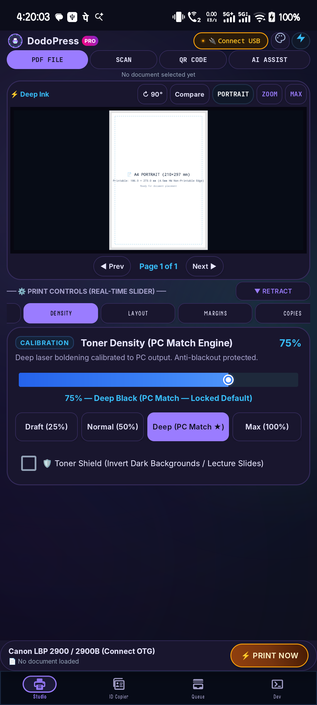
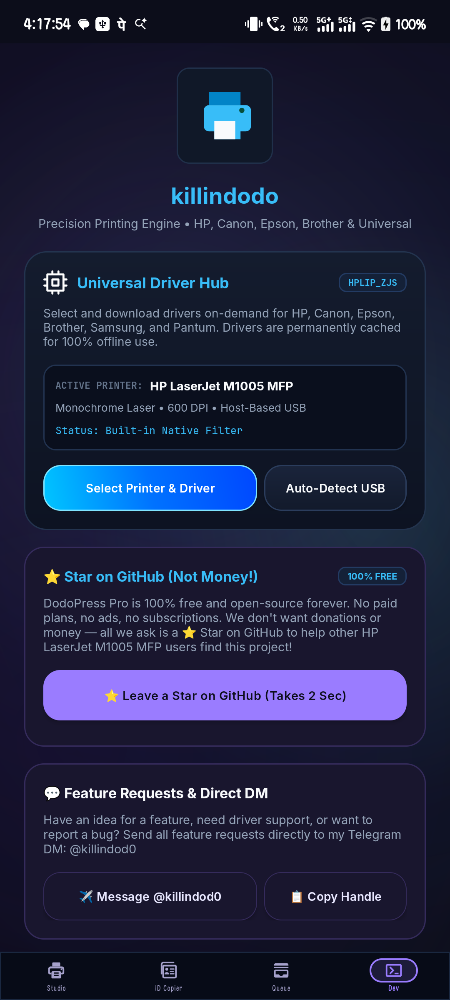
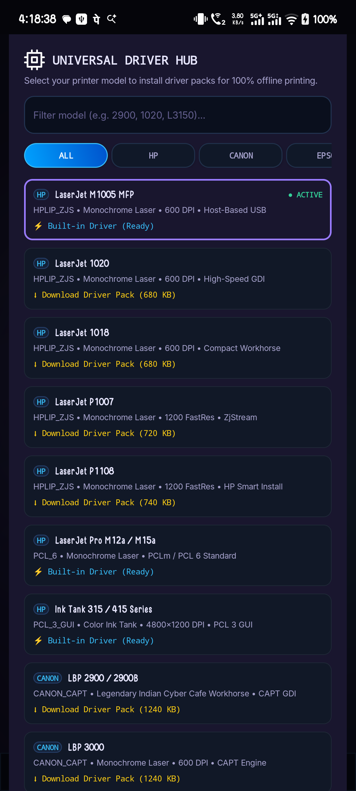
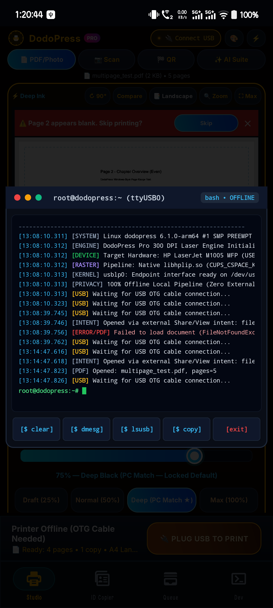
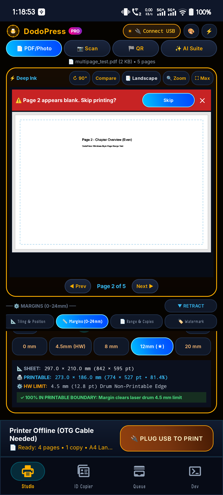
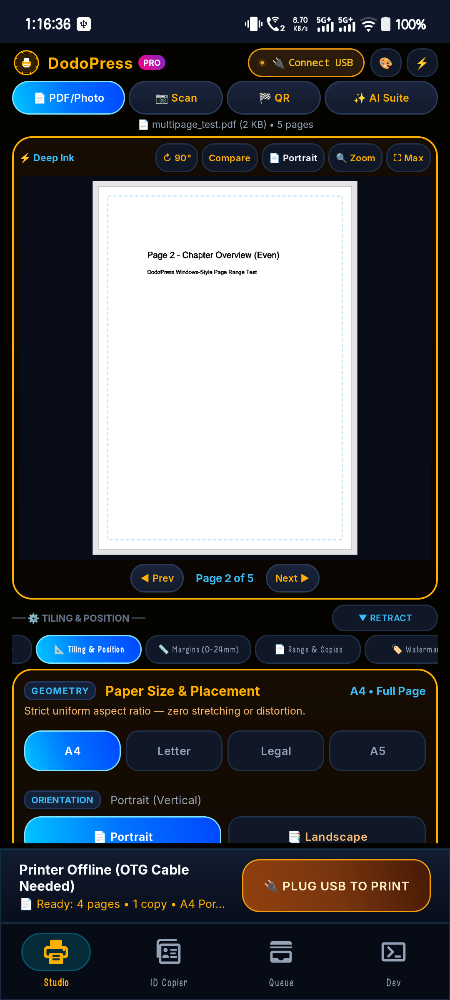

# DodoPress 🖨️

> **Offline USB OTG Direct Printing Station for Android**  
> Direct hardware communication with GDI, CAPT, ZjStream, ESC/P-R, PCL6, and SPL printers over USB OTG — no cloud, no print spooler daemons, no bloat.

[-brightgreen.svg)](https://developer.android.com)
[](LICENSE)
[](DodoPress.apk)
[](#hardware-architecture)
[](https://github.com/killindodo)

---

## ⚡ The Problem DodoPress Solves

Most Android printing solutions rely on cloud print relays, vendor-locked plugins, or heavyweight background services that fail on legacy or host-based (GDI) hardware. When you plug an HP LaserJet (M1005 / P1007), Canon LBP (2900 / 3000), or Epson inkjet directly into a phone via USB OTG, Android's default print framework simply does not know how to speak to them.

**DodoPress** bridges this gap. It turns any Android device into an offline, high-speed industrial printing terminal by directly claiming the USB interface, converting documents into native printer raster streams on-device, and piping raw packets directly through the bulk-out endpoint.

---

## 📸 Screenshots

| 01. Print Studio & Preview | 02. Hardware Driver Hub | 03. Driver Model Catalog |
|:---:|:---:|:---:|
|  |  |  |
| **Real-Time Physical Sheet Canvas** | **Multi-Protocol Driver Engine** | **Extensive Hardware Catalog** |

| 04. Linux Konsole Telemetry | 05. Millimeter Margin Controls | 06. ID Card Duplicator |
|:---:|:---:|:---:|
|  |  |  |
| **USB Packet & Endpoint Telemetry** | **0–40mm Physical Margins** | **Multi-Up Tiling with Cut Guides** |

---

## 🚀 Core Capabilities

### 1. Direct USB OTG Bulk-Out Engine
- Uses Android's low-level `UsbManager` and `UsbDeviceConnection` to claim printer bulk endpoints (`UsbConstants.USB_ENDPOINT_XFER_BULK`).
- Streams multi-megabyte compressed page rasters in chunked packets (8 KB–32 KB buffers) with proactive endpoint status polling and stall recovery.
- Operates entirely offline without internet permissions, cloud accounts, or background daemons.

### 2. Universal Protocol & Driver Hub
DodoPress includes a modular driver registry supporting multiple printer command architectures:
- **HP ZjStream (`HPLIP_ZJS`)**: Zenographics ZjStream protocol for HP LaserJet P1005, P1006, P1007, P1008, P1505, M1005 MFP, and M1120.
- **Canon CAPT (`CANON_CAPT`)**: Canon Advanced Printing Technology GDI protocol for LBP2900, LBP3000, LBP6000, and related desktop laser models.
- **Epson ESC/P-R (`EPSON_ESC_PR`)**: Compressed raster stream protocol for Epson EcoTank, WorkForce, and Stylus inkjets.
- **PCL 6 / PCL-XL (`PCL_6`)**: Standard industrial page description protocol for HP, Brother, Ricoh, and Lexmark network/USB laser printers.
- **Samsung SPL (`SAMSUNG_SPL`)**: Samsung Printer Language for ML-1610, ML-1640, ML-2160, and SCX-series multifunction units.
- **Standard PWG Raster (`GENERIC_PWG`)**: High-compatibility 1-bit / 8-bit page raster stream for modern driverless hardware.

### 3. Bitonal 1-Bit Halftone & Density Pipeline
- Industrial-grade **Floyd-Steinberg error diffusion** and **Bayer 8x8 ordered matrix dithering**.
- Custom gamma curve and black-point clipping slider (10% to 100%) to match desktop PC dark toner density (default calibrated at 75%).
- Fast native Java memory buffers avoiding intermediate disk I/O during raster generation.

### 4. True Physical Sheet Preview & Geometry Engine
- Aspect-ratio accurate sheet visualization for **A4** (210×297mm), **A5** (148×210mm), **Letter** (8.5×11"), and **Legal** (8.5×14").
- Live millimeter-accurate hardware margins (0 mm to 40 mm) with real-time bounding box guide visualization.
- Instant orientation toggle (Portrait / Landscape) and scaling modes (`Fit Entire Page`, `Fill / Crop`, `Exact Millimeter 1:1`).

### 5. ID Card Duplicator & Precision Tiling
- Built-in multi-up layout generator for ID cards, driver licenses, badges, and certificates.
- Layout options: **1-Up**, **2-Up**, **4-Up**, and **Max-Fill** automatic grid packing.
- Configurable dashed cut lines with millimeter offset markers for quick scissor or paper cutter trimming.

### 6. Hardware Telemetry & Linux Konsole
- Integrated interactive terminal showing real-time USB bus descriptors, interface endpoints, transfer baud rates, and raw handshake hex logs.
- Immediate visual diagnostics for troubleshooting USB cable impedance, OTG adapter drops, and printer busy states.

### 7. Custom Vector UI & Dynamic JetBrains Mono Typography
- Handcrafted custom vector icons optimized for high-DPI displays.
- Hardware-themed palettes with live dynamic theme switching:
  - **Obsidian OLED** (pure black industrial contrast)
  - **Paper Studio** (monochrome drafting aesthetics)
  - **Cobalt Command** (deep blue aerospace cockpit)
  - **Sandstone Warm** (natural parchment layout)
  - **Aether Aurora** (vibrant modern slate gradient)
  - **Cyber Matrix** (hacker terminal neon green)

---

## 🛠️ Architecture & Data Flow

```text
  +------------------------------------------------------------------+
  |                        Input Document                             |
  |                (PDF / Image / Scanner Capture)                   |
  +---------------------------------+--------------------------------+
                                    |
                                    v
  +------------------------------------------------------------------+
  |                       DodoPress Core                             |
  |                                                                  |
  |   +-----------------------+           +----------------------+   |
  |   | SheetGeometry Engine  |  ------>  | Bitonal Halftoner    |   |
  |   | (Aspect, Margins, ID) |           | (Bayer 8x8 / Floyd)  |   |
  |   +-----------------------+           +----------------------+   |
  |                                                  |               |
  |                                                  v               |
  |   +----------------------------------------------------------+   |
  |   |                    Driver Hub Protocol                   |   |
  |   |  [ZjStream]  [Canon CAPT]  [ESC/P-R]  [PCL6]  [SPL]      |   |
  |   +----------------------------------------------------------+   |
  +---------------------------------+--------------------------------+
                                    |
                                    v
  +------------------------------------------------------------------+
  |                Android USB Host Subsystem                        |
  |    UsbManager -> UsbInterface -> UsbEndpoint (Bulk OUT 0x01/0x02)|
  +---------------------------------+--------------------------------+
                                    |
                                    v
  +------------------------------------------------------------------+
  |              Physical Printer (Over USB OTG Cable)               |
  +------------------------------------------------------------------+
```

---

## 🔧 Building from Source

DodoPress is designed with zero third-party build bloat. It compiles directly using official Android command-line tools without requiring Gradle or heavyweight IDE dependencies.

### Prerequisites
- JDK 17+ (`javac`, `keytool`, `zip`)
- Android SDK (`build-tools/34.0.0+` or `36.0.0`, `platforms/android-34`)

### Build Script (`build.sh`)
```bash
# Clone the repository
git clone https://github.com/killindodo/DodoPress.git
cd DodoPress

# Ensure executable permissions and build
chmod +x build.sh
./build.sh
```

The script automatically:
1. Compiles vector resources and layouts with `aapt2`.
2. Compiles Java source files with `javac --release 17`.
3. Dexes bytecode with `d8`.
4. Bundles native driver libraries (`arm64-v8a`).
5. Runs `zipalign` and signs the final package using `apksigner`.

The output APK is generated at `./DodoPress.apk` (~2.6 MB).

---

## 📲 Installation & Quick Start

1. Download [`DodoPress.apk`](DodoPress.apk) or build it from source.
2. Install the APK on your Android device (`adb install DodoPress.apk` or tap the APK in file manager).
3. Connect your printer to your phone or tablet using a standard **USB OTG adapter**.
4. Grant USB permission when prompted by Android.
5. In DodoPress:
   - Select your document or image.
   - Adjust page margins, paper size, and tone density in the **Print Studio**.
   - Tap **Print Now** — the job streams directly to the printer hardware.

---

## 🗺️ Supported Protocols & Hardware

| Protocol Family | Representative Models | Status |
|:---|:---|:---:|
| **HP ZjStream** | HP LaserJet P1005, P1006, P1007, P1008, M1005 MFP, M1120 | Verified |
| **Canon CAPT** | Canon LBP2900, LBP2900B, LBP3000, LBP6000 | Verified |
| **Epson ESC/P-R** | Epson L3110, L3150, L3210, EcoTank Series | Active |
| **PCL 6 / PCL-XL** | Brother HL-series, HP OfficeJet / LaserJet Pro | Active |
| **Samsung SPL** | Samsung ML-1610, ML-1640, ML-2160, SCX-3400 | Active |
| **Generic PWG Raster** | IPP / USB class printers supporting PWG bitonal | Active |

---

## 💬 Community & Feedback

Built by **killindodo** for anyone who needs reliable, no-nonsense hardware printing on Android.

- **Developer / Creator**: [killindodo](https://github.com/killindodo)
- **Telegram Direct Support & Feature Requests**: [@killindod0](https://t.me/killindod0)
- **Bug Reports & Issues**: [GitHub Issues](https://github.com/killindodo/DodoPress/issues)

---

## 📄 License

Licensed under the Apache License, Version 2.0 (the "License"). See [LICENSE](LICENSE) for details.
